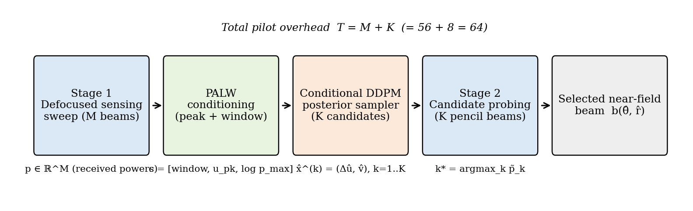
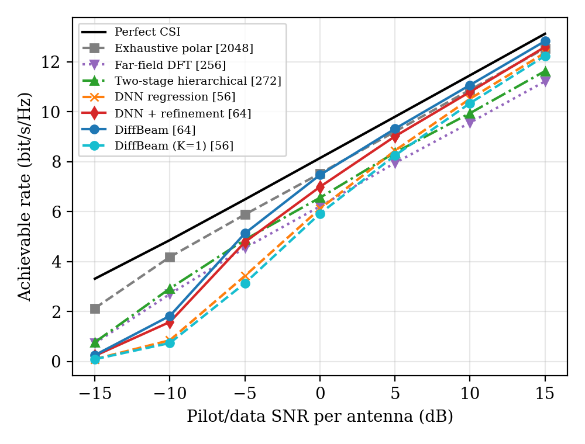

# DiffBeam

**Generative Diffusion Posterior Sampling for Pilot Efficient Near Field Beam Training in Extremely Large Scale MIMO Systems**

Official implementation of the DiffBeam framework.  
Author: Dr G. Arul Dalton, Department of Computer Science and Engineering, Saveetha Engineering College, Chennai, India.



## Overview

XL-MIMO arrays at mmWave and sub-THz frequencies place users in the radiating near field, where beams must be focused in both **angle and distance**. DiffBeam treats near-field beam training as **conditional posterior sampling**:

1. **Defocused diverging sensing codebook.** *M* = 56 wide beams with negative wavefront curvature cover the sector and encode distance.
2. **Peak-anchored local-window (PALW) conditioning.** Estimation is anchored at the strongest sensing beam, so the network learns a fine offset instead of an absolute position.
3. **Conditional DDPM.** A denoising diffusion model samples *K* = 8 diverse angle–distance hypotheses.
4. **Over-the-air probing.** The *K* candidate focusing beams are tested and the strongest is selected.

Total pilot overhead is **M + K = 64**, compared with 2048 for exhaustive polar search.

The whole implementation is **pure NumPy**: no PyTorch or TensorFlow is needed, and everything runs on a laptop CPU.

## Repository structure

```
DiffBeam/
├── diffbeam/               # core library
│   ├── config.py           # system & algorithm parameters (Table II)
│   ├── channel.py          # near-field channel, probing, rate  (eqs. 1-5)
│   ├── codebooks.py        # defocused sensing, DFT, polar codebooks (eq. 7)
│   ├── conditioning.py     # PALW conditioning & target mapping (eqs. 8-9)
│   ├── nn.py               # NumPy MLP + Adam with manual backprop
│   ├── diffusion.py        # conditional DDPM training & sampling (eqs. 10-11)
│   ├── model.py            # DiffBeamModel (save / load checkpoints)
│   └── schemes.py          # DiffBeam (Algorithm 1) + all baselines
├── scripts/
│   ├── train.py            # train denoiser + DNN baseline
│   ├── evaluate.py         # Figs. 3-5, Table III, runtime
│   ├── ablation.py         # Table IV
│   ├── make_figures.py     # regenerate all figures
│   └── demo.py             # quick inference demo
├── checkpoints/            # pretrained models used in the paper
├── results/                # JSON results reported in the paper
├── figures/                # paper figures
├── tests/test_diffbeam.py  # unit tests
├── run_all.sh              # full reproduction pipeline
├── requirements.txt  LICENSE  CITATION.cff
```

## Installation

```bash
git clone https://github.com/iitrky/DiffBeam.git
cd DiffBeam
pip install -r requirements.txt
```

## Quick start

```bash
python scripts/demo.py                 # pretrained inference, ~10 s
python -m pytest -q                    # unit tests
```

## Reproducing the paper

| Step | Command | Time (1 CPU core) |
|---|---|---|
| Train proposed model | `python scripts/train.py` | ~6 min |
| Train ablation models | `python scripts/train.py --sensing dft --out checkpoints/diffbeam_dft_palw.npz`<br>`python scripts/train.py --conditioning global --iters 12000 --out checkpoints/diffbeam_defocus_global.npz` | ~11 min |
| Main experiments | `python scripts/evaluate.py` (`--quick` for a smoke test) | ~5 min |
| Ablation | `python scripts/ablation.py` | ~2 min |
| Figures | `python scripts/make_figures.py` | seconds |

You can also run everything at once with `bash run_all.sh`. Pretrained checkpoints are included, so training can be skipped.

## Key results

These are rates in bit/s/Hz for *N* = 256 antennas at 100 GHz, with users at 4–30 m.

| Scheme | Pilots | 0 dB | 10 dB |
|---|---|---|---|
| Perfect CSI | – | 8.14 | 11.46 |
| Exhaustive polar codebook | 2048 | 7.53 | 10.87 |
| Two-stage hierarchical | 272 | 6.56 | 9.94 |
| Far-field DFT sweep | 256 | 6.21 | 9.56 |
| DNN + refinement | 64 | 6.99 | 10.79 |
| **DiffBeam (proposed)** | **64** | **7.47** | **11.07** |



Results are Monte-Carlo estimates, so re-running gives values within a few hundredths of bit/s/Hz.

## Citation

```bibtex
@article{aruldalton2026diffbeam,
  author  = {G. Arul Dalton},
  title   = {Generative Diffusion Posterior Sampling for Pilot Efficient Near Field Beam Training in Extremely Large Scale {MIMO} Systems},
  journal = {(under review)},
  year    = {2026}
}
```

## License

This project is released under the MIT License (see `LICENSE`).
